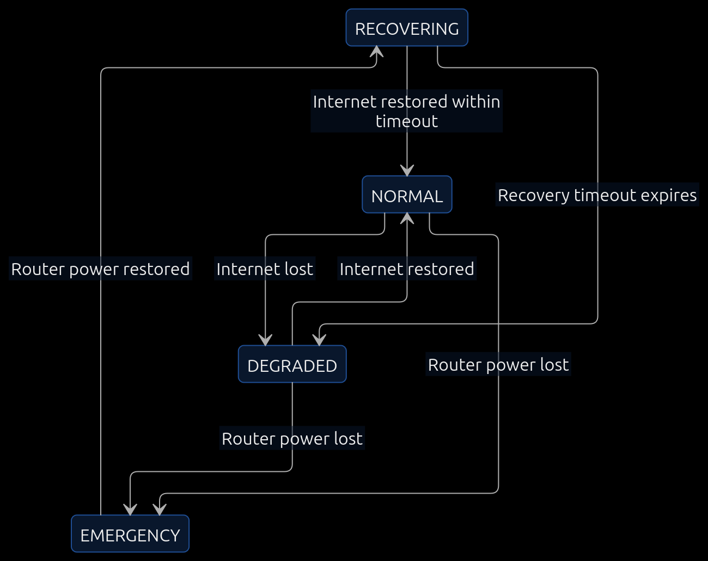

# TinySystem
**An autonomous Linux infrastructure management system with power-aware network orchestration and recovery.**

## State diagram

## States

| **Event**                         | **Transition**
|-----------------------------------|----------------------------------
| Router loses power	            | NORMAL / DEGRADED → EMERGENCY
| Router power returns	            | EMERGENCY → RECOVERING
| Internet returns within T seconds	| RECOVERING → NORMAL
| T seconds expire without internet	| RECOVERING → DEGRADED
| Internet drops again	            | NORMAL → DEGRADED
| Internet returns	                | DEGRADED → NORMAL

## Operations

**NORMAL**

Router online (home router has power + internet)
- DNS resolve continues.

**DEGRADED**

Home router has power, but no network connectivity.
- No additional infrastructure takeover.
- Maintain logs.
- Reserved for future functionality.

**EMERGENCY**

Home router loses power.
- TinySystem assumes router responsibilities.
- Maintains local network access to the archive.

**RECOVERING**

Home router regains power.

- Relinquish router responsibilities.
- Return to DNS-resolving operation.
- Wait for internet recovery timeout.
- Internet returns → NORMAL.
- Timeout expires without internet → DEGRADED.

