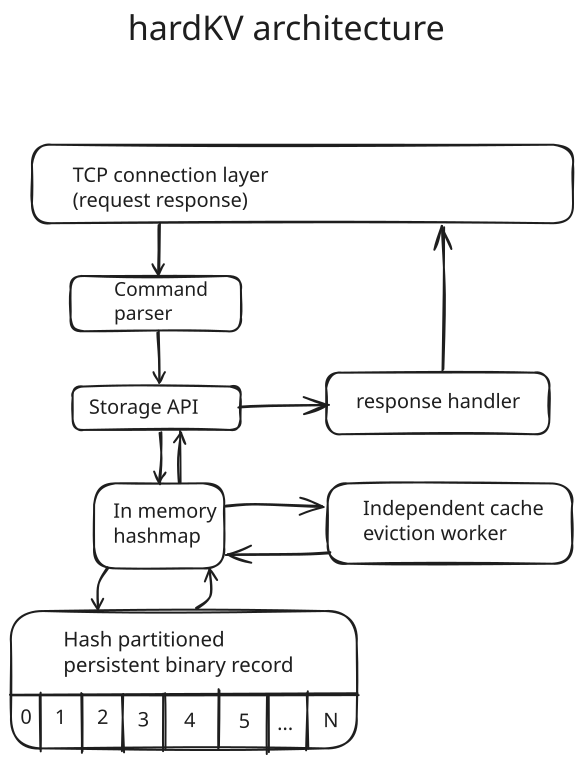

# hardKV
**A persistent key-value system with first-class caching and storage.**

hardKV is a key value database with cache and append-only persistent records written in C, designed around the idea that in-memory caching and persistent storage deserve equal architectural importance.

Unlike architectures where persistence supplements an in-memory store or caching supplements a persistent database, hardKV treats both as fundamental components of the system. 

## Core Philosophy

- **First-class caching:** Efficient in-memory access with configurable eviction policies.
- **First-class persistence:** Append-only, partitioned binary storage designed for persistent data.
- **Independent lifecycles:** Cache eviction does not imply persistent data deletion.
- **Concurrent access:** Bucket-specific cache synchronization and partition-specific disk synchronization.
- **Explicit data management:** Cache eviction and persistent deletion are distinct operations.


## Setup
```bash
$ git clone git@github.com:smsadat1/tinysystem.git
$ cd tinycache
$ sudo ./setup.sh
```

## Commands

| Command             | Purpose                    
| --------------------|-------------------------- 
| `SET <key> <value>` | Store/update a key         
| `DELETE <key>`      | Remove a key               
| `GET <key>`         | Retrieve a value           
| `LIST <prefix>`     | Get key values from pattern match
| `EXIST <key>`       | Check whether a key exists 
| `EVICT <key>`       | Remove the entry only from cache
| `STAT`              | Status                     
| `PING`              | PING PONG             


## Configurations
Configuration is stored in:

```text
/etc/systemd/system/hardkv.conf
```

The configuration file determines the locations of the persistent database and replay log.


## Command-line Options

**Eviction policy**

Use LRU (set by default)
```bash 
$ tinycache --eviction lru 
```
Use LFU 
```bash
$ tinycache --eviction lfu
```

**Cache memory limit**

Set the cache capacity to 128 MB:
```bash
$ tinycache --mem_max_mb 128
```

Set the cache capacity to 256 MB:
```bash
$ tinycache --mem_max_mb 256
```

## Architecture
**Architecture diagram**


## Design Notes
- In-memory hashmap for caching.
- Persistent hash partitioned append only binary records on disk.
- LRU is the default eviction policy.
- LFU uses LRU as tie breaker.
- Eiction worker and cache operations use a mutex lock, except `PING`.