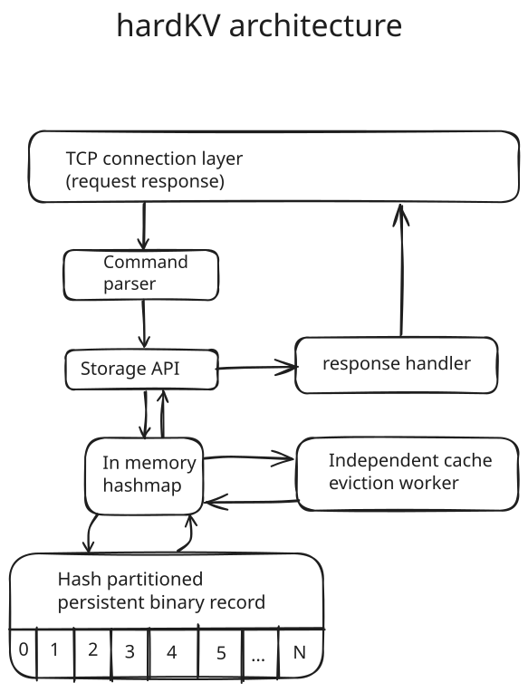

# Architecture

**Architecture diagram**


**Startup sequence**
```
hardKV starts
  │
  ├── Check CLI args for policies and configurations
  │
  ├── Initialize cache
  │
  ├── Launch eviction worker in separate thread
  │
  └── Start accepting TCP connections
```


## Operations

```text
SET <key> <value>
  ├── lock cache
  ├── update cache
  ├── update LRU 
  ├── unlock cache
  └── send "OK" to client
```
**Happens in a single mutex lock**

```text
DELETE <key> <value>
  ├── lock cache
  ├── update cache
  ├── update LRU
  ├── unlock storage  
  ├── unlock cache
  └── send "OK" to client
```
**Happens in a single mutex lock**

```text
GET <key>
  ├── lock cache
  ├── search value
  ├── update LRU 
  ├── unlock cache
  └── send <value> to client
```
**Happens in a single mutex lock**

```text
EXIST <key>
  ├── Cache hit → Update LRU → send "Y" to client
  └── Cache miss → Search disk records
                    ├── Found → Populate cache → Update LRU → send "Y" to client
                    └── Absent → send "N" to client
```
**Happens in a single mutex lock**

```text
EVICT <key>
  ├── Cache hit → Remove entry from cache → Update LRU → send "Y" to client
  └── Cache miss → send "FAILED" to client
```
**Happens in a single mutex lock**


```text
STAT KEY ── send client <number of keys in cache>
STAT MEM ── send client <number of used bytes in cache>
```
**Happens in a single mutex lock**

```text
PING ── send "PONG"
```
**No mutex lock**

